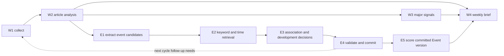

# Hapag-Lloyd Treasury Intelligence — System Specification, Plan v7

**Version:** 3.1 — Event-owned priority scoring and automatic event tracking
**Updated:** 2026-10-31 (Asia/Singapore)
**Status:** Accepted and implemented Event-scoring contract. Workflow E is enabled by default; [section 15](#15-event-owned-priority-scoring) scores committed Event versions instead of new articles. Legacy article scores and published reports remain readable and immutable. See [implementation status](IMPLEMENTATION.md) for delivered behavior, offline validation and separate real-provider evidence. Examples and target dataset sizes are not measured results.

## 1. Scope and relationship to v6

The engine discovers material events from public regulatory, macroeconomic and shipping news, links subsequent reporting to those events, maintains evidence-backed developments, and supplies follow-up searches and weekly briefs. Users configure monitoring interests; they need not register every real-world event beforehand.

This is the active design for new work. [Plan v6](plan%20-%20v6.md), including its v2.8 major-change amendment, remains the implementation baseline for existing W1–W4 behavior. Its article identity/revision handling, W2 evidence and ranking rules, W3 major-change policy, W4 semantic review, cumulative weekly reporting, immutable publications and bounded execution remain required unless explicitly replaced below.

| v6 contract | v7 replacement |
| --- | --- |
| All tracked events are user-defined; no automatic event creation | User-defined **Watches** coexist with automatically discovered **Events** |
| `event_labels` identifies the only trackable objects | Retain `event_labels` as the compatible manual Watch interface; introduce separate Event IDs |
| Only three SQLite tables; tracking lives in article/run JSON | Add persistent event, mention, development and Watch–Event association records |
| W2 owns user-event progress | W2 retains article analysis and manual labels; E owns canonical Event developments; Watch goal assessment remains separate |
| Default `general` means no tracked event | `general` means no specific manual Watch match; an article may still have automatic Event associations |
| Gold forbids any model-created event | E gold explicitly labels discovery, event identity, developments and uncertain associations |
| W4 can expose only user-watch updates | W4 may also expose validated Event snapshots and developments |
| W2 scores individual articles and W4 selects by article score | Section 15 moves priority scoring to each committed Event state version; news remains evidence, and W4 selects by the matching Event score |

These replacements supersede corresponding prohibitions in v6 scope, storage, prompts, examples, evaluation and definition of done. W1 and W4 still cannot invent or mutate Event records. The LLM proposes extraction and association; validated code commits identity and state.

No Treasury exposure model, financial transaction execution, new agent framework, vector database or BM25 dependency is included in this version.

## 2. Domain model

### 2.1 Watch, Event, Development and Article

**Accepted business definition:** An Event is an occurrence with a clearly defined subject and business scope that can be tracked over time as the same matter. A Development is an update within that occurrence; an Article/Mention provides the supporting evidence.

- **Watch:** A user-defined monitoring objective, such as following Suez service returns. It may cover many events and may be continuous.
- **Event:** One specific business occurrence tracked across its lifetime, including announced or unverified occurrences. Its identity is scoped by actors, underlying action/condition, business scope, location/jurisdiction and occurrence time where supported. Identity does not change merely because its phase or headline changes.
- **Development:** An evidenced update, pending claim, corroboration, conflict, correction or resolution within that occurrence. It has its own time and evidence qualification.
- **Article:** An independently stored source revision. Events reference articles; they do not copy or replace them.
- **Mention:** A source-grounded reference to an occurrence and its reported development, linked to an immutable Article revision and a numbered source range. Code resolves that range to saved text and offsets. A mention can be unresolved without creating an Event.

For one port strike, announcement, extension, possible reopening and confirmed ending
belong to the same Event when their occurrence identity is supported. Another port's
strike or an explicitly separate later strike is a different Event. Shared actors,
topics or causal/background relationships alone do not establish identity. Do not
merge every disruption at the same port into an unlimited topic thread. An ending
can be extracted as a development without creating a separate parent occurrence.

Association and truth are separate decisions. A qualified claim can belong to a
known Event while remaining unverified; association does not advance verified state.
Possible future reopening is not automatically a contradiction of an ongoing strike.

Watch–Event and Article–Event relationships are many-to-many. Event–Development is one-to-many. Several independent articles may support the same development. An article's `group_id` remains a syndication group and must not become an Event ID.

An event's factual verification and lifecycle are independent:

- `verification_status`: `unverified`, `confirmed`, `disputed`.
- `lifecycle_status`: `announced`, `ongoing`, `resolved`, `unknown`.

A confirmed announcement of planned reopening does not establish actual resolution. Search inactivity only changes follow-up scheduling; it never establishes completion. Importance and source count do not establish truth. Syndications are not independent corroboration.

### 2.2 Evidence and time

Every mention and development references an immutable article revision and a source range. The model returns inclusive numbered segment IDs (`source_range: {start, end}`), not copied text or character counts. Code stores the selected original text plus zero-based, end-exclusive character offsets (`source_start`, `source_end`). Validate range order and membership in the supplied chunk; do not require literal wording for the subject, scope, location or identity explanation. Source grounding is semantic, while range integrity is deterministic. Titles and summaries are not identity keys. Unknown actors, times and locations remain unknown; do not fill them using unsupported model knowledge.

Store separately:

- `event_time`: the supported start/anchor or interval of the underlying occurrence. The initial implementation uses nullable `event_at` for the anchor; interval/precision modeling remains future work.
- `development_at`: explicit time of this particular update, nullable. Ending/restoration dates do not replace the underlying occurrence's start. Missing times stay null; source publication may be an ordering fallback, never an extracted occurrence date.
- `published_at`: the source publication timestamp.
- `known_at`: when the system first accepted the information, preserved on replay.
- `recorded_at`: when a particular decision/version was committed.

Historical queries require the version and evidence to have been known by the cutoff. A future planned occurrence can be known now; do not exclude it merely because its event time is in the future. Missing event time must not be silently replaced by publication time.

## 3. Architecture and ownership

The diagram includes implemented E5 version scoring from section 15. W2/W4
article-scoring clauses in earlier amendments describe the historical baseline
and are superseded by section 15; their source-evidence contracts remain active.



### W2 source-range amendment

New W2 facts use `{fact, source_range: {start, end}}` with the same one-based,
inclusive sentence/paragraph segment IDs as E. W2 receives the complete current
article as numbered segments once, in one article-analysis request; numbering is
not per-segment execution. Code resolves the ranges to immutable source text and
character offsets. Code checks range integrity; the semantic review amendment below owns factual,
summary and scoring-explanation support. A model-generated quotation is not required.

Save matching `fact_evidence` records alongside the compatible string `facts`
list, including the original article revision ID, range, excerpt and offsets.
Duplicate analyses inherit the evidence's original source identity. Legacy
analyses omit this field and remain immutable. Reject invalid source ranges and
unsupported facts; retain valid facts when only part of the response fails.
Zero accepted facts fail W2 without committing analysis. W3 recovery reuses saved
W2 evidence. Scoring, R5, optional follow-up resolution and duplicate-provenance
rules remain unchanged. Old prompt checkpoints require their original rules;
new runs may process pending articles without rewriting completed analyses.

E and W3 independently consume completed W2 evidence. Neither requires the other to succeed. Persisted numeric signals remain owned by W3; E may retain an evidenced qualitative change without duplicating numeric extraction. W4 resolves exact saved W3 signals using existing source/reference rules.

Initial E execution is ordered by eligible article publication/discovery time, revision and ID, with serial event association and a single database writer. Later articles in the same batch see previously committed events. Do not run parallel independent create decisions against stale candidate pools in the first release.

### W2 and E semantic review amendment

This amendment replaces W2's deterministic prose/summary support checks and E's
separate conditional identity and per-mention completion review calls. W3 numeric
extraction and R5 scoring anchors are unchanged.

**W2:** Generate one article analysis, resolve its fact ranges against the current
saved revision, then review all facts, the summary, scoring explanations and claim
status in one LLM call. The reviewer receives numbered source text, the proposed
analysis and fixed company context. It judges semantic support, including equivalent
units, negation, proposals, attribution and unsupported company exposures; literal
word/number matching is not the prose acceptance gate. Code retains schema, source
identity/range integrity, duplicate provenance and weighted-score calculation.
A negative verdict permits one full-analysis repair, which may remove unsupported
facts and must update dependent summary/scoring explanations. Re-review the repaired
analysis once. Save only an analysis whose complete final review passes; otherwise
fail that article without committing W2 or altering an earlier completed analysis.

**E:** After extraction and bounded retrieval/association, review every supplied
mention and decision in one batch against numbered source evidence and its own
retrieved Event candidates. Review extraction fidelity, occurrence identity,
development meaning and actual completion together. Replace the previous separate
identity/completion model calls. Preserve independent lifecycle/verification state
and the authoritative-source requirement for confirmed resolution. A procedural
ending can retain an ongoing occurrence; unestablished completion cannot advance
verified state. The reviewer cannot grant source authority or invent Event IDs.

The review support flags assess the supplied proposal, not only attachment to an
existing Event or confirmed progress. `identity_supported` can be true for a
source-supported `create` or justified `defer`; the absence of a matching retrieved
Event neither proves novelty nor by itself invalidates creation. `development_supported`
can be true for a new Event's initial development or a faithfully qualified
`pending_claim`. An unconfirmed claim must not advance verified state, but does not
require deferral when occurrence identity is independently supported. A shared actor
or location alone still cannot establish identity. Review the extraction's action
label together with its verification, lifecycle, attribution and cited source range.

Rejected E proposals permit one repair batch, limited to the rejected mention
indexes, their supplied source neighborhoods and their own retrieved candidate IDs.
The repair may revise the mention and decision together, or explicitly decline.
Re-review repaired proposals once; unresolved source/identity/development support
becomes defer with no verified Event advancement. Review outages, invalid review
coverage or invalid repaired contracts fail the article before the atomic commit.
Raw cached E1 extraction is retained; semantic repairs are separate audited proposals.
A completed deferred decision remains visible and does not cause automatic reruns.

Both stages record proposed output, verdicts/reasons, repair outcomes and final
acceptance in saved run metrics. A structurally invalid review response gets at most
one contract repair per review batch; this is separate from the single semantic
content-repair batch. API failure never implies approval. There is no unbounded
repair loop. W2 review calls are shared across eligible batches as specified below; normal E uses one review call instead
of zero to three former identity/completion calls. Repairs add one generation and
one review call, excluding bounded contract/transport retries. Empty E extraction
requires no association review and is not proof of perfect event recall.

New prompt/rule versions participate in saved execution manifests. Completed
historical analyses are reused, not silently reviewed or rescored. Resuming an old
logical run requires its original rules; new runs can process pending inputs.
Evaluation must distinguish deterministic orchestration checks from measured live
semantic accuracy and preserve the old baseline and failed runs.

### W2 cross-article review batching amendment

Generate W2 proposals in chronological order, then review up to five independent
articles in one `W2BatchSemanticReview` request. `w2_review_batch_size` is configurable
from 1 to 10 (default 5); 1 retains single-article review. Bound each batch's serialized
article payload by `w2_review_batch_max_bytes` (default 60000); an oversized article
runs alone without truncation. This is a batching target, not a provider token estimate.
Every review item carries its exact article_id and its own numbered source segments.
Require exactly one verdict per article and one assessment per fact. Evidence from
another article cannot support a claim, even when segment numbers overlap.

Provisional earlier proposals may appear only as explicitly marked duplicate-search
candidates. Never inherit their analysis before approval. A duplicate proposal against
an uncommitted candidate flushes the earlier batch and is reconsidered against saved
analyses. Same-URL revisions, configured Watches and outstanding follow-up work form
serial barriers. A proposal introducing follow-up work flushes the batch before the
next article. W3 feedback produced while committing a batch becomes available to the
next batch; a speculative proposal never resolves a follow-up or advances Watch/E state.

Checkpoint drafts and their frozen inputs before review. Commit approved articles in
source order, one at a time, with their own W3 work and processing checkpoints. On
resume reuse compatible drafts for unfinished W2, and skip committed W2. A rejected
article permits one individual full-analysis repair; all successfully repaired articles
in that batch share one recheck. Preserve passing siblings when another article's
repair fails. Invalid batch coverage gets one contract retry; persistent invalid coverage
or transport outage fails the affected unresolved batch, never implicit approval.

The client distinguishes invalid model-output errors from transport/provider failures.
Successful HTTP responses with invalid JSON/schema receive the bounded contract retry;
network errors, refusals and incomplete responses remain explicit service failures.
OpenRouter may fail over between providers of the same requested model while requiring
parameter support and denying provider data collection. This does not switch models,
change acceptance rules or increase the two-retry SDK limit. Receipts retain the
requested routing policy and returned provider when reported; SDK HTTP attempt counts
do not claim to count unreported gateway routing hops.
Record batch membership, calls, per-article verdicts, repairs and final statuses. For ten
independent articles with no repair and batches of five, ten generation calls plus two
review calls replace twenty calls. Barriers, size limits and repairs can increase this.

## 4. Workflow E contracts

### E1 — Extract primary candidates

Input: one saved article revision, its accepted W2 facts and relevant source body. Extract zero to two principal Treasury-relevant event mentions. A second candidate must be independently material. Empty output is valid completed work.

Each candidate contains an input-local mention handle, subject(s), action, place/jurisdiction, optional explicit identifier, optional event-time interval, principal change, an evidence source range, factual qualification and open public questions. The model does not assign persistent Event IDs or invent aliases. Candidate content is treated as untrusted until validated.

In the current contract, `action` and `scope` describe the underlying occurrence;
`source_range`, `development_at`, proposed `lifecycle` and `verification` describe the
reported development. Preserve the parent strike scope when extracting an extension
or an ending. These fields do not require loading future news or a full event history.

Cache the validated result, including empty output, separately from W2. Extraction failures must not erase W2 or W3 results.

Prompt examples cover every applicable output category. E1 has six examples covering all four lifecycles, all three verification states, and empty extraction. E3 has eleven examples covering all five decisions, all seven development kinds, all three identity relations and all three non-null distinctions. Examples include independent corroboration versus repetition, explicit new occurrences versus postponements, and actual ending versus possible reopening. The unified review has ten examples covering source, identity, development and completion judgments; the repair prompt has three examples. Their entities and inputs differ from the frozen development benchmark; that benchmark is still not an independent holdout.

### E2 — Retrieve existing events

Use the deterministic keyword/time policy in §5. Retrieval performs no provider calls. Results include stable IDs, snapshot versions, scope, relevant state/evidence, matched terms and ordering reasons. The candidate list is context for comparison, not an assertion of shared identity.

### E3 — Propose association and progress

Provide the current candidates, retrieved events and their relevant evidence. Batch candidates from the same article into one normal association call. The association decision is one of:

E1 owns consolidation into primary mentions. E3 and its semantic reviewer preserve
the supplied mention indexes and return one decision/assessment for each; they cannot merge,
drop or renumber them. Candidate eligibility is per mention, even when two mentions
appear to concern the same occurrence. A missing eligible match requires the
existing bounded expansion or defer, never an unrelated match selected to satisfy
the response contract. During the single contract repair, the response schema
binds each mention index to its own retrieved IDs (plus null for create/defer).
Bindings are rebuilt for each request after expansion. Program validation remains
authoritative for decision semantics, exact coverage, evidence, source and time.
This is a reference constraint, not a text-length or output-token limit.

First assess `identity_relation`: `same_occurrence`, `distinct_occurrence` or
`uncertain`. Then propose a development kind independently of source verification.
The relation must agree with attach/corroborate/conflict, create or defer respectively.
Creating beside a same-actor candidate requires a `distinction` of different scope
or separate occurrence, with `evidence_range` referencing numbered segments within
the supplied mention source_range. There is no model-generated quotation or
verbatim-match acceptance gate. The range supports review, not a code-level proof
of semantic distinctness.
Model-facing candidate/evidence contexts expose numbered source ranges, not
storage-only character offsets. Association and its bounded repair receive the
eligible segment IDs for each mention; evidence ranges use those IDs exclusively.
Program-owned offsets remain in stored provenance for audit.

| Decision | Meaning |
| --- | --- |
| `create` | A distinct new event is supported by source evidence |
| `attach` | Associate with an existing event; propose a development or `no_change` |
| `corroborate` | Add supported coverage of an existing fact, without another material progress entry |
| `conflict` | Attach an evidenced conflicting claim without silently replacing the verified state |
| `defer` | Insufficient evidence to determine identity; persist an unresolved mention |

Code derives the initial kind for `create` from candidate lifecycle and source qualification, and derives `corroboration`/`conflict`/`no_change` for corresponding decisions. An unverified non-conflicting claim is recorded as `pending_claim` even when identity is clear. Invalid extraction or association contracts may receive one bounded repair per call, recorded separately.

Development kinds are `new_development`, `pending_claim`, `corroboration`, `conflict`, `correction`, `resolution`, `no_change`. A resolution proposal must concern the event's actual condition and scope, with confirmed authoritative completion evidence. Ending negotiations does not end a continuing strike. Ending an investigation, approving or prohibiting a deal, or finalizing a consent order does not establish actual acquisition closing or abandonment. The business occurrence spans regulatory jurisdictions, procedural phases, remedies and replacement terms; consolidate multiple updates to that occurrence into one mention. A facility's changed terms or eligibility remain progress within that facility, while separate facilities and regulatory rules remain distinct.

After association, one `EventSemanticReview` batch reviews all mentions, including
extraction support, identity and development meaning. Each non-conflicting,
non-deferred `resolved` candidate has a nested completion assessment with
`actual_completion`, `procedural_progress` or `not_established`, a lifecycle,
source range and rationale. Context retains the cited segments and at most one
neighbor on each side, separately scoped to each mention. The completion verdict
may correct lifecycle without another model call. Only actual completion with
confirmed E1/W2 qualification and program-verified provenance can advance to
resolved. Procedural progress stays open; unsupported completion stays pending.
The semantic repair/recheck limits in the amendment above apply. Preserve raw E1,
reviewed proposals, before/after decisions, reasons and provider receipts.

The primary-source policy includes exact FTC press-release paths, CMA announcements on `www.gov.uk/government/news/`, and US Treasury releases on `home.treasury.gov/news/press-releases/`, with issuing-authority cues, saved readable text, publication time, HTTPS and anti-syndication checks. Neither a government domain alone nor model assertions establish authority. Manual Watch completion continues to use its existing separate policy.

Confirmation follows the accepted E1/W2 source claim; a non-primary source is not automatically pending. For a confirmed, non-conflicting lifecycle change, code normalizes `corroborate`/`pending_claim` into `attach` plus `new_development` or `resolution`. Resolution still passes the authoritative completion gate. Unconfirmed claims never advance verified state. Association and each semantic review batch permit at most one contract repair, with rejected and repaired JSON retained in diagnostics. Content repair is separately bounded to one batch and one recheck.

The batch identity assessment checks both creation and attachment, including
same-actor creation, actor/identifier mismatches, changed occurrence anchors and
progress linked to resolved occurrences. These are semantic considerations, not
automatic merge/split rules: a postponement or correction can retain identity.
A recurring Watch must not absorb distinct occurrences into one Event.

An existing ID must come from the supplied retrieval results. A create proposal carries scope and evidence, not a model-invented persistent ID. Do not create a duplicate merely because the first retrieval returned no match. If retrieval coverage is uncertain, use the bounded expansion in §5 or defer.

A clearly different actor with a supported occurrence can justify creation even
when action keywords retrieve unrelated events. After retrieval, a proposed creation
beside a same-actor candidate receives at most one additional identity-review call
per article. That reviewer can attach a phase change, preserve an evidenced separate
occurrence or defer; it cannot automatically merge on actor equality. Review output
must pass the same contract and authority checks, with no recursive review loop.

### E4 — Validate and commit

Code validates structure, cited article revisions, excerpts, allowed references, source qualifications, chronology and idempotency. Semantic model judgments remain measured judgments, not guarantees established by matching an excerpt.

Within one transaction: save accepted mention associations, allocate new IDs, append developments, update the event projection/version, update Watch associations as applicable, and commit the processing checkpoint. Do not hold a write transaction open during a model call.

Reject a stale event-version decision and refresh its context under a bounded retry policy. An exhausted retry remains deferred/failed with the last valid event state preserved. Uncertain or conflicting claims do not overwrite confirmed developments. Corrections and reassociations append auditable decisions and supersede old associations rather than deleting source history.

Material-progress deduplication considers evidence that actually established verified
state. A pending/conflicting mention cannot suppress a later confirmed development
with the same source text, including confirmation through explicit reconciliation.
It must still pass chronology and completion-authority checks. Preserve the earlier
pending history and remove the now-confirmed claim from the active pending list.
Previously established unchanged developments remain deduplicated even after their
evidence leaves the compact display window.
An authoritative, confirmed correction may restore a previously established
statement after retracting a later state. Deduplicate corrections against the
current verified statement and lifecycle, not every historical statement. A
repeat of the current state adds evidence without fresh material progress; older
evidence still cannot roll back a newer verified state. Preserve the superseded
state at historical cutoffs.
A material authoritative correction supersedes the preceding verified trajectory
for progress deduplication. Rebuild that boundary from the immutable ledger; a
later authoritative, completion-reviewed resolution can establish the same text
again after retraction, while older evidence and repeats of the restored state
remain non-progress. This changes current deduplication, not historical snapshots.

## 5. Keyword retrieval and time ordering

### 5.1 Query construction and eligibility

Construct one query per main mention, keeping different actors and locations separate. Normalize Unicode, case and punctuation; use word/phrase boundaries for Latin text. Use explicitly configured/source-backed entity aliases. Chinese terms require documented segmentation or explicit phrase matching; do not assume whitespace tokenization handles Chinese. No inferred synonym/alias silently changes entity identity.

Search compact event documents containing scope/title, canonical subject and aliases, location, explicit identifiers and relevant accepted developments. Avoid indexing repeated full syndicated articles as additional evidence weight.

Regular scope: events with material developments in the last 90 days, plus non-resolved events. Explicit historical references can retrieve archived events outside the window. Resolved events remain eligible within the applicable scope. Unknown time does not automatically exclude a keyword match. Only versions/evidence known at the run cutoff are eligible.

### 5.2 Matching and ranking

Recall the union of identifier, subject/location and fact-keyword matches. Match phrases literally after normalization; do not interpret input as SQL or executable query syntax. Use parameterized database access.

Sort candidates lexicographically by:

1. Exact explicit identifier match.
2. Subject-plus-location match, then subject-only match.
3. Number of distinct informative action/fact query terms matched; repetition does not increase this count.
4. Temporal order: distance to an explicit queried event-time interval when both sides have a compatible known event time; otherwise recent accepted material evidence time descending. Known comparable times rank before unknown times within this tie-break. Publication time may order untimed evidence, but remains labeled as publication time.
5. Stable Event ID for deterministic ties.

The keyword policy and stopword/alias configuration are versioned. Shared numbers, generic words such as “news”, article popularity and source count must not establish identity. A match in a disputed claim must remain explicitly disputed in the returned evidence.

Keep at most 20 ranked matches for audit, return the first five event snapshots to E3, subject to the context budget. Record total eligible/matched counts and any truncation. These values are initial configurable limits, not measured optimal settings.

### 5.3 Bounded expansion

Allow at most two retrieval rounds total: initial retrieval and one expansion. Expansion may use additional explicit aliases, relax action keywords or include historical events beyond the normal window. Subject contradictions are not erased by expansion. An uncertain identity/defer triggers the remaining expansion even if the model forgets its expansion flag. Empty results, weak matches or truncation may also justify expansion; low-confidence residual associations remain deferred.

## 6. Context and call budgets

Initial settings to validate during evaluation:

```yaml
events:
  enabled: true
  retrieval:
    lookback_days: 90
    max_audit_candidates: 20
    max_candidates: 5
    max_rounds: 2
  context:
    max_input_tokens: 8000  # Legacy name: extraction chunk sizing target in conservative bytes
    max_output_tokens: null  # No application-imposed output cap
    max_tokens_per_candidate: null  # Disable legacy per-candidate byte admission
```

Workflow E is enabled by default for new CLI and API runs. Set `events.enabled: false` to opt out; the standalone `events` command explicitly enables E. Resume retains the saved run configuration, including its original E setting. Starting the API service alone does not execute a workflow. W1–W4 settings are unchanged.

CLI progress goes to stderr: startup, run IDs, stage/count updates, a 30-second
heartbeat during execution and the final status. Stdout retains the single final
JSON result and existing exit codes. `--quiet` suppresses progress; it does not
change execution or checkpoint persistence. A heartbeat indicates process liveness,
not provider success.

Use a shared context builder to count the complete request, including system instructions, schema, source text and candidate snapshots. The default output limit is null: omit API max_tokens/max_completion_tokens and let provider/model limits apply. Event text fields have no artificial maxLength constraints. Keep bounded retrieval/chunking, but do not reject a complete request based on the conservative UTF-8 byte estimate; if an explicit output limit is configured, validate its reservation too. This does not make the provider context unlimited. Record finish_reason and completion usage so actual truncation can be distinguished from schema or semantic failures. Record the counting method; if no exact tokenizer is available, use a conservative estimator and handle provider rejection as a context failure, not a silent successful abstention.

The old whole-request 8,000-byte gate is removed: byte estimates are not provider token counts and must not block a repair/review request. `max_input_tokens` remains the source-segment chunk sizing target for compatibility; fixed prompts, schemas and examples do not consume that source-body target; actual provider token usage is recorded. Even when two mentions retrieve five candidates each, keep retrieval and evidence selection bounded. Deduplicate shared candidates, prioritize direct evidence and record omissions. Retain actor, time, negation, unit and adjacent contextual sentences. Event summaries are navigation aids; fetch original evidence before accepting a consequential state change.

The current projection supplies identity fields, match reasons, the complete latest
evidence excerpt and the complete first anchor excerpt. `max_tokens_per_candidate`
defaults to null: the legacy 1,600-byte candidate admission gate is disabled, including
in evaluation and demos. Evidence record count remains bounded to anchor plus latest,
with omitted history counts explicit; neither retained excerpt is clipped. An explicit
numeric legacy budget still enables the old byte gate for compatibility. Whole-request
admission is left to the provider using its actual context window; provider rejections
remain explicit failures. Cross-mention candidate deduplication remains an optimization.

Oversized articles may require bounded paragraph-based extraction batches, each with source offsets; merge and select at most two primary candidates afterward. Record chunk coverage and partial/unprocessed content. Do not present truncation as a complete no-event finding. Budget exhaustion yields a visible incomplete/deferred result.

Ordinary short articles with mentions use one E1, one E3 and one batched semantic
review call. Empty extraction skips E3 and review. One expanded retrieval can add
one association call. Rejected semantic content permits one repair batch and one
recheck, regardless of whether there are one or two mentions. Contract repairs,
chunking and transport retries have separate limits and receipts; the ordinary
call count is not a global upper bound. Do not use unbounded recursive retrieval.

Changed policy/prompt manifests require explicit reconciliation of completed
historical E jobs. Failed work reuses compatible raw E1 extraction, never an
obsolete semantic approval. The active rule is `events-v6-unified-semantic-review`.

## 7. Persistence, caching and recovery

Extend the current SQLite schema through an explicit versioned migration:

| Record | Required responsibilities |
| --- | --- |
| `events` | Stable code-owned ID, scope, current verification/lifecycle projection, version, follow-up schedule |
| `event_mentions` | Immutable source revision, candidate/extraction version, evidence, accepted/deferred association history |
| `event_developments` | Event ID, kind, evidence links, event/publication/knowledge/commit times, correction/supersession links |
| `watch_event_links` | Watch ID and definition version, Event ID, association evidence and decision history |

Processing checkpoints may use a dedicated table or versioned run records, but must persist E1 and E3 independently. Expose E `pending/completed/failed/skipped` status separately from W2/W3. Duplicate articles can inherit display associations; they do not generate independent progress.

Retain append-only completion coverage at the frozen E cutoff, including empty and
skipped inputs, atomically with the mutable current job checkpoint. The existing
mention ledger reserves negative indexes for metadata (-1 source correction,
-2 completion coverage); these are not event mentions or unresolved work. Historical
coverage uses accepted decisions/coverage markers after any source correction.
Legacy current jobs prove coverage only when their saved cutoff is early enough;
missing historical empty/skipped evidence remains unknown rather than invented.

Explicit reconciliation freezes the complete eligible article-ID scope, including
completed/skipped inputs. Prioritize unfinished or changed-manifest inputs.
`max_articles_per_run` bounds attempted articles in each reconciliation invocation
(including resume), not the size of this saved scope. A resume skips compatible
inputs already committed by the same logical run and advances to the remainder;
failed attempts consume batch slots. Unattempted articles remain in
`remaining_articles`, forcing partial status until the tail is drained. Failures
and unresolved associations independently prevent success. A fresh reconciliation
is a new forced scope; it prioritizes still-changed inputs but does not replace
resume for completing an existing scope. Ordinary backfill selection remains
bounded per logical run. Do not expand legacy truncated scopes retroactively.

E1 reuse depends on immutable article revision, relevant W2 evidence revision, extraction prompt/schema and policy versions. E3 records a frozen candidate snapshot/manifest and the accepted decision identity. A successful unchanged replay returns the committed result even if unrelated events were later added. Registry growth must not automatically rebind all historical mentions.

Source corrections invalidate dependent event projections and W4 manifests. Explicit reprocessing or reconciliation can supersede decisions, but must not count unchanged evidence as fresh progress. Preserve old decisions and publication versions. Event identity must not depend on model-generated titles or incidental phrasing.
Unresolved-mention counts use the same cutoff-aware processed source revision
eligibility as event snapshots. Resolve the latest eligible revision per normalized
URL across the full catalog before restricting to a run's article IDs. A superseded
revision's deferral stays in history but cannot block current E completion or W4;
future/unprocessed revisions do not hide it, and a deferred replacement still counts.
Event evidence, Watch–Event links and article–Event links share the same active
mention projection: latest mention slot, eligible processed source revision and no
later source-correction marker. Ledger order breaks equal-knowledge-time ties, so
a correction invalidates preceding links and a subsequent accepted reassociation
can restore them. Historical links remain queryable before the correction cutoff.

Current projections include only sources and evidence supported by active mentions
at the cutoff. Withdrawal of non-material corroboration or pending evidence also
removes it from displayed sources, retrieval evidence and active pending claims.
Keep the first active anchor and recent evidence within the compact view; an empty
active evidence list must not fall back to a withdrawn excerpt. Verified-progress
deduplication excludes withdrawn or superseded support while retaining the ledger.

Atomically enforce at-most-once accepted progress for a logical source-revision/mention/decision identity. Changed prompts alone must not duplicate the same supported development. Exactly-once database effects do not imply exactly-once provider calls after a response-before-commit crash; report both separately.

Historical backfill is an explicit bounded command over saved W2 articles; it performs no W1 collection or unnecessary W3 calls. A failed E stage is resumed independently. Database migration must not trigger paid bulk inference.

## 8. Existing Watches and downstream integration

`general` is W2's fallback classification label, not a Watch to link and not an Event. E3 receives only linkable Watch definitions. Optional unknown/reserved Watch IDs are filtered, duplicate IDs are collapsed, and before/after decisions are audited; invalid optional links do not fail the automatic event. Actual Event identity is independent of these labels.

Retain `event_labels`, `general`, manual article labels and historical watch records. Introduce separate automatic Event references; never write discovered Event definitions into `config.yaml` or the manual registry. Adding an Event must not trigger full-registry rematching.

- A narrowly scoped, evidence-backed existing Watch can link to its corresponding Event after identity validation.
- A broad or continuous Watch links to multiple Events; its own goal assessment remains separate from their lifecycle.
- Ambiguous legacy mappings stay unmapped/pending. Manual membership is a retrieval hint, not proof of Event identity.
- Event progress has one canonical owner, E. Watch displays project linked Event developments and preserve legacy evidence without applying each change twice.

W1 receives due public follow-up questions with the appropriate typed Watch/Event reference. Validate references against persisted records; a query is not an Event. Follow-ups share the existing search budget, preserve area/category discovery coverage, and use bounded retry/backoff. No-news results do not resolve an event.

W4 reads frozen Event snapshots known at its observation cutoff, with supporting article revisions. Weekly event changes are selected from the reporting interval while permitted historical context retains provenance. Add snapshot versions, relevant associations and evidence to the manifest; corrections invalidate dependent conclusions. E gaps are reported as partial event coverage while valid article-based content remains usable. W4 cannot mutate Events and may not reconstruct numeric signals from narrative event summaries.

Published brief versions and historical articles remain immutable. Export schema/version changes and compatibility with existing `tracked_events` consumers must be specified and tested before enabling E in ordinary collection.

For weekly automatic-event updates, consider events linked to selected reporting-week
articles and load their saved historical supporting revisions, independently of
manual Watches. Use reporting-week selection order and stable event ID; include
at most 20 events and at most 100 support articles in total across Watches and
automatic Events. Require support to have been known/processed by the weekly cutoff
and preserve publication-time checks. Missing or over-limit support yields an
explicit coverage gap; unrelated catalog events do not create weekly gaps.
Evaluate E processing coverage at that same weekly cutoff. A current completed job
whose first E processing occurred after week-end cannot establish historical coverage;
report the missing historical coverage even if the current event queue has drained.

## 9. Synthetic persistent demo

The following sequence is fictional and begins with an empty Event store and no manually registered Delta/Echo strike Watches. Event IDs below are explanatory handles, not expected generated IDs.

| Article | Evidence | Expected result |
| --- | --- | --- |
| A01 | Delta port announces a strike beginning October 20 | Create E001; announced |
| A02 | Syndicated copy of A01 | Reuse association; no independent development |
| A03 | The same Delta strike is extended to 72 hours | Attach to E001; one material development |
| A04 | Echo port announces a 72-hour strike | Create E002; shared duration does not merge ports |
| A05 | An unconfirmed report says Delta may reopen | Attach a qualified pending claim; do not resolve E001 |
| A06 | Delta's authority confirms that this strike ended and operations resumed | Resolve E001 with cited evidence |
| A07 | Delta announces a separate strike next month | Create E003 after checking E001's scope |

Use one persistent SQLite database and the same production E functions. Show extracted mentions, retrieval trace, associations, development timeline and final states. Repeat the sequence with the same inputs: no new Events, material developments or successful-stage model calls. Inject a failure after E1 and after the database commit; resume to the same final state.

An optional Watch replay adds a specific Delta October watch and a broad port-disruption watch. The specific Watch maps to E001; the broad Watch may include E001–E003 and is not closed by E001's resolution. One article reporting both ports must support multiple Event associations without duplicate article storage.

## 10. Evaluation design

All benchmark runners/scorers/renderers are collected in `evaluation/`, with
`benchmark.py` as the unified CLI and a versioned suite profile and dataset index.
Offline checks, synthetic live controls, authentic-source E evaluation, W3 robustness
and W1–W4 live integration remain separately identified. Each invocation produces
native reports plus one JSON/HTML/PNG/SVG index and a code/data/model/settings manifest.
Resume preserves completed failures as well as successes; incompatible manifests
require a new output directory. Do not pool their metrics into an overall accuracy.

### 10.1 Data and labels

Evaluate chronological article sequences, not isolated model responses. Reuse [EpiMine](https://github.com/pkargupta/epimine) news/episode labels and [KeyEvents](https://aclanthology.org/2023.findings-emnlp.274/) clustering data where applicable, recording provenance and availability. These datasets do not by themselves provide Treasury lifecycle, uncertainty or Watch ground truth; add independently reviewed labels for those tasks.

Each case labels primary mentions and evidence, event membership, existing-vs-new identity, development kind, expected state after each article, and optional Watch associations. Include uncertainty rather than forcing every mention into a definite event. Require actual source support; do not derive gold from the evaluated model's output or injected mock replies.

The development starter `event_sequences_v3.json` preserves all seven v2 source/W2
inputs and event memberships. It changes the unconfirmed reopening's development
label from `conflict` to `pending_claim` under §2.1. Preserve `event_sequences.json`
and historical reports unchanged. Score identical new predictions against both label
versions so label changes are not presented as model-quality gains. Run three live
repeats for this development smoke; they are not independent real-news samples.

Split entire events across development and held-out sets, with chronological separation. Keep entity/number variants of one template in the same split. Freeze annotation guidelines and acceptance targets before the held-out live run. Synthetic cases prove contracts and edge cases; their counts do not establish population accuracy.

Start with five live smoke sequences, then approximately 30 sequences of 5–10 articles (150–300 articles), with two independent repeats. Dataset availability and labeling quality determine the final documented composition; these are planned sizes, not completed measurements.

The first real-source expansion is `event_sequences_real_v1.json`: 72 unique official
releases, 23 business occurrences, and two interleaved chronological streams of 36
sources each. It is annotated by the Codex assistant at the user's request, before
the first live predictions; it is not independently human-adjudicated. Preserve
the original seven-source synthetic benchmark. Source paragraphs, publication dates,
hashes, scope definitions, per-row reasons and confidence flags are frozen alongside
the dataset. Date-only timestamps are normalized encodings and replay discovery times
are simulated, not asserted historical observations. See the
[dataset card](docs/event-real-dataset.md) for selection, attribution and uncertainties.

Each real-source run freezes production prompts, retrieval and authority policy in
its manifest. Subsequent policy fixes run from fresh databases against unchanged labels
and sources, retaining earlier reports. After inspecting these results to improve
prompts or policy, treat this corpus as a development benchmark, not an unseen holdout.
Do not change labels or remove failures to fit predictions. Planned expiry is
not completion, regulatory clearance is not completed acquisition, and jurisdictional
or remedy changes may be developments of the same business acquisition. Flag ambiguous
scope/state labels for future independent adjudication. Count distinct source URLs
separately from repeats, report the full denominator and the high-confidence state
subset, and reject incomplete/overlapping/mismatched stream report aggregation.

### 10.2 Layered scoring

| Layer | Controlled input | Metrics |
| --- | --- | --- |
| E1 | News article and saved W2 facts | Primary-event precision/recall, unsupported mentions, justified abstention |
| E2 | Gold candidate query and gold prior-event corpus | Recall@5, Recall@20, no-match rate, candidate counts |
| E3 | Fixed candidate list containing the correct event when one exists | Association errors, false merges, duplicate creation, deferred decisions |
| State | Labeled ordered developments | Missed/repeated progress, false resolution, correction/late-news handling |
| End-to-end | Production E1–E4 and its own accumulated database | Event grouping, development/state accuracy, coverage and cost |

Retrieval recall denominators include only mentions whose correct event already exists and is eligible at that time. Report retrieval using gold candidates separately from retrieval using E1 output. New events are evaluated for appropriate creation, not penalized for absent historical matches. Deferred links count separately and contribute to unresolved coverage when a definite gold link exists.

Report association for all steps, nonduplicate steps, new occurrences, existing
occurrences and duplicate inheritance separately; expose false merges/splits and
deferred steps. Stage failures remain in end-to-end quality denominators and have
their own execution-failure count. Report conditional live retrieval recall separately
from a future gold-corpus retrieval benchmark. Preserve E1 outputs and identity-review
before/after decisions in each failure record.

Match generated IDs to gold identities using supported mention memberships, allowing multi-event articles; do not grade titles or generated ID strings literally. Use frozen association/cluster metrics that penalize both false merges and splits. Check every retained claim and state change; an event-count mismatch must never bypass evidence checks. Automated rule scoring and human-reviewed semantic labels remain distinguishable; another LLM's verdict alone is not independent ground truth.

### 10.3 Runner, recovery and reporting

Each sequence/repeat starts a fresh database. Resume uses the original database and frozen manifest. At each step ingest only the current article, run E, inspect persisted results and score against hidden gold. Never put future articles or gold IDs into prompts/retrieval indexes.

Freeze hashes of datasets, source/configuration, prompts, model, retrieval/alias policy and simulated clock. Save per-article results after every commit. Record actual provider receipts, tokens, latency, service failures, cache reuse and costs; separate stage errors from quality mismatches. Replay an unchanged completed sequence and verify zero extra successful-stage calls.

Deliver `report.json`, standalone `report.html`, and PNG/SVG plots for scenario results, error types, Recall@K and repeat consistency. Failure views include source evidence, retrieved candidates, ordering reasons, decisions and persisted state. Use existing receipt/checkpoint/report infrastructure where practical; event scoring must remain independent of W3's numeric oracle.

Required recovery cases: E1/E3 failure isolation, response-before-commit crash, post-commit crash, same-URL corrections, syndication, multi-event articles, late reports, Watch edits and historical cutoff isolation. All operations/recovery regressions must pass. Model quality thresholds are recorded before held-out execution and reported with numerators/denominators; no production accuracy claim is made before measurement.

## 11. Implementation sequence and deliverables

| Milestone | Main files / deliverables | Acceptance |
| --- | --- | --- |
| 1. Contracts | `schemas.py`, versioned prompts, this spec | All demo decisions representable; validated empty and uncertain outputs |
| 2. Persistence | `store.py`, schema migration, E checkpoints | Old data preserved; atomic commits; repeat/crash recovery |
| 3. Retrieval | New `event_retrieval.py`, fixtures and checks | Deterministic keyword/time ranking, cutoff and archive cases |
| 4. E execution | New `events.py`, context builder, `orchestrator.py` E/resume/backfill paths | Independent stage retry, bounded calls, persisted decisions |
| 5. Integration | Watch adapter/links, `collect.py`, `exports.py`, `w4_brief.py`, viewer as needed | Discovery budget preserved; correct historical snapshots and compatibility |
| 6. Evaluation | New `demo_events` and `evaluate_events.py`, gold sequences, reports | Persistent demo, offline regressions, live smoke then scaled evaluation |

The names and commands above are implementation targets. The first runnable milestone is a persistent empty-store-to-timeline demo. Follow with Watch/W1/W4 integration and scaled real-API evaluation. Preserve all existing W3 and W4 regression checks; report v7 implementation progress separately from this accepted design.

## 12. Frontend workflow invocation

The HTTP adapter exposes the existing full W1 → W2/W3 → optional E → W4 workflow
as an asynchronous, persisted job. E follows server configuration. It does not
replace stage ownership, scoring rules, source validation or immutable storage.
R5 and existing historical scores remain unchanged.

- Submission returns 202 and a stable job ID; an idempotency key and identical
  options reuse that job without repeating provider calls. Different options
  under the same key conflict. Only one API job may write a database at a time.
- Status exposes persisted stage checkpoints, attempt number and root run ID.
  Results expose article rankings (including score explanations and Event links),
  the versioned weekly brief and explicit partial coverage. No raw provider
  responses, execution prompts, credentials or local paths enter job responses.
- The full-workflow E child freezes the complete eligible W2 article-ID scope.
  Its configured article limit bounds attempts per invocation; resume keeps the
  same child/cutoff, reuses completed checkpoints and drains the tail without W1
  searches being repeated. This does not force reconciliation or change standalone
  CLI backfill scope. A legacy child whose scope was truncated fails explicitly
  with a new-job instruction instead of silently widening its saved input scope.
- In full-workflow/API and collection-backed brief runs, create/freeze the W4
  child only after enabled E processing succeeds. While E remains incomplete,
  expose article results and partial coverage without publishing a dependent brief.
  Resume can then build W4 from the completed E scope. Existing frozen publications
  remain immutable; refreshing a historical brief requires a new logical run.
- CLI `process` combines W2/W3 and E statuses in its export, result and exit code.
  A completed-but-incompatible E checkpoint cannot hide a reconciliation error.
- The root checkpoint is saved before paid work. Explicit resume reuses its
  cutoff, config, model, rules and child checkpoints; incompatible rule changes
  reject recovery. Interrupted pre-commit calls may repeat. Request retries must
  not increment an attempt more than once.
- API metadata and result snapshots live in a separate durable SQLite database.
  Abrupt restart marks unfinished jobs interrupted without automatic paid retries.
  One process lock prevents multiple API workers for the same article database;
  CLI/scheduler writers must be scheduled separately.
- Default binding is local. Remote use requires authenticated access, explicit
  frontend origins and server-owned provider credentials. This version provides
  no tenant isolation, distributed task queue or cancellation endpoint.

The accepted request/result contract, launch commands, OpenAPI location and
frontend polling example are in [current HTTP operations](docs/v2/operations.md#http-and-viewer). HTTP tests
cover full recorded-provider execution, partial/failed outcomes, idempotency,
concurrency, restart recovery, authentication and CORS alongside existing stage
regressions. Execution success does not establish semantic model accuracy.

## 13. Portable instruction package

The user-requested `skills/treasury-intelligence/` packages these business rules
and stage prompts for direct execution by a host agent. It preserves the Event /
Development / Article distinction, W3/E independence, keyword/time retrieval,
bounded reviews, evidence qualifications and unchanged scoring rubric. It contains
instructions, references, templates and synthetic examples, with no executable
scripts or dependency on the engine program or workflow API.

Host-provided search/read/file tools determine available capabilities. Markdown
records and explicit continuation handoffs are separate from the engine's canonical
SQLite state; the skill cannot claim transactional, concurrent or background-job
guarantees. Default reports contain a summary, news ranking, event developments,
article-specific score explanations, sources and coverage gaps. Charts require
supported comparable data and native host rendering. Program benchmark results
do not establish the skill's model quality; the bundled expected report is synthetic.


### Read-only automatic event viewer

Streamlit exposes Automatic events separately from manual Watch progress. It reads
`automatic_events` from the selected article export, shows lifecycle and verification
independently, and displays scope, current summary, bounded source evidence and
reconciliation warnings. Article rankings expose `event_ids` and associated event
details. Empty/legacy exports explain that no events are present without claiming
E failed. Selecting or refreshing an export does not invoke a model or alter state.

## 14. Quality, throughput and incremental acceptance

The acceptance target applies separately to initial processing and incremental
processing: W1, W2, W3, E and W4 each require accuracy (including applicable state
accuracy) and execution success strictly above 85%. Discard is below 5% of valid
input news lacking an analysis result. Event deferrals are reported separately;
they must not be disguised as successful associations. Failures remain in quality
denominators. Each cohort must contain 100 valid new articles and complete within
300 seconds, measured from W1 collection start through saved W4 output, including E.
Replay, cached articles, duplicate inputs and frozen W2 inputs do not establish this
full-workflow throughput target. Missing gold or insufficient coverage is unverified,
not passed. Incremental results must be reported separately rather than averaged
with the initial cohort. Compatible replay must perform no extra model calls;
source revisions and interrupted execution must preserve unaffected completed work.

Retrieval remains literal keywords plus time, with explicit identifiers first,
distinctive business-scope keywords next (those present in at most one third of
the visible catalog, with a minimum of one entry, excluding generic program/phase
words), then distinctive literal words from the saved mention evidence, subject/location, all
matched scope keywords, action keywords and the existing temporal/stable-ID tie
breakers. Named subjects remain scope terms; a program name must not disappear
from retrieval merely because it is also the extracted subject. The
five-candidate context bound remains. A program extension is a Development of the
existing program; it must not reset a confirmed ongoing occurrence to announced.
Only a supported correction can make that regression. Future program operation
is announced until supported evidence establishes actual activity. Transaction
review or negotiation in progress is ongoing; the transaction resolves only upon
actual closing or abandonment, not regulatory approval alone.

HTTP 402 or structured provider credit-exhaustion errors stop further LLM calls
on that client and all its forks. Already in-flight requests may finish. E stops
its article loop on fatal service errors, saves the failed checkpoint and reports
unattempted remaining work. Partial runs never establish acceptance. Real API
reports must retain source/model/config provenance and distinguish measured
quality from offline contract tests. Existing frozen gold labels remain unchanged.

E extraction can opt into batches of up to eight independent single-chunk articles
(`events.extraction_batch_size`, default one until real validation). Each returned
article ID must occur exactly once and its ranges resolve only against that article.
All batch members validate before any extraction checkpoint is saved. Invalid batch
contracts fall back to the existing individual extraction path; provider failures do
not trigger batch retries. Multi-chunk articles keep their current bounded chunk path.
Cached extractions survive resume. Retrieval, association, review and Event commits
remain chronological, so later articles see earlier accepted developments. Batching
must never be described as achieving the throughput target without measured evidence.

Completed schema-invalid W2 and W3 drafts receive one contract repair using the
same source context. E extraction and association include schema errors in their
existing single repair budget, rather than treating them as transport failures.
Refusals, truncation, service errors and credit exhaustion do not get draft-contract
retries. All repaired results still undergo the existing source/semantic checks;
no fallback fact or state is invented to reduce discard.


W2 may opt into bounded independent draft generation with
`w2_generation_workers` (one by default; eight in the full-workflow diagnostic).
Workers read immutable article inputs and never access SQLite. Chronological
candidate selection, duplicate inheritance, Watch/follow-up barriers, semantic
review and persistence remain on the main thread. Only first revisions with the
fallback Watch can be prefetched. If ordered context supplies follow-up/Watch state,
a same-URL predecessor, identical text, or any candidate satisfying the existing
duplicate-provenance predicate, discard the independent draft and use normal
dependent preparation. Exact-text siblings are not prefetched. Complete unused
drafts and call receipts are retained for compatible resume, but every resumed
independent draft must pass the same dependency gate before review.

The single E semantic repair has one schema/coverage retry, just like semantic
review. It must cover every rejected mention exactly once and use that mention's
source range. This does not authorize a second content-repair cycle or acceptance
without the separate semantic recheck.


E can opt into `events.association_workers` (one by default; eight in the full-workflow
diagnostic) after extraction checkpoints exist. Workers perform association and
semantic review against frozen snapshots and never access SQLite. The main thread
still consumes results and commits in chronological order. Before accepting a
speculative result after the catalog changes, rerun its original literal retrieval
queries with the same cutoff and expansion settings. Reuse only if every supplied
candidate snapshot is unchanged. Otherwise perform one fresh association/review
against the current catalog before commit. The existing transactional epoch and
version guards remain active. Source-only extraction checkpoints are retained;
uncommitted speculative decisions are not reusable state. Receipts include unused
and refreshed inference; report refresh counts instead of hiding their time/cost.
Reconciliation stays serial. Fatal provider failures stop new work; already in-flight
workers finish and their receipts remain visible.

Extraction retains all original source candidates. When more than one candidate
remains, whether from a single chunk or multiple chunks, one article-level primary selection chooses one or two existing
candidate indices, consolidating repeated details/phases of the same occurrence.
Selection cannot rewrite source ranges or create new candidates; index validation
has one contract repair. Its result is checkpointed independently of raw extraction.
Selected proposals still undergo association and semantic review before persistence.
The extra selection call and any repair remain in timing and receipt metrics.

Association repair schemas correlate each decision kind with its ID and identity
relation: create/defer use null IDs; attach/corroborate/conflict use an eligible
non-null ID for that mention. Parsed repairs normalize to the public contract before
semantic review. This prevents invalid null associations without inventing identity.
The real E CI aggregate applies a separate strict >85% quality gate per domain and
overall, retaining failed rows and requiring complete coverage and zero-call replay.
This gate does not establish full-workflow accuracy or throughput.

W3 preserves supported headline observations even when a neighbouring value is not
a valid comparison. Lack of a comparable baseline alone does not require dropping
the current observation or an explicit material direction. The one/two-signal limit,
source validation, delta arithmetic and scoring remain unchanged. Live W3 CI adds
strict >85% gates for labeled output accuracy, execution success, source safety and
positive-signal retention; synthetic frozen-W2 results are not full-workflow proof.

W2 keeps temperature zero where supported. The fixed-sampling GPT-5/GPT-6
model families omit the unsupported temperature parameter while retaining strict provider
parameter support and privacy settings; model defaults are recorded in receipts.

With independent W2 draft generation enabled, an article receives only saved
follow-up questions that its body can satisfy under the existing minimum word
overlap evidence rule. Both this eligibility check and final resolution validation
use canonical source evidence text (including Unicode/HTML normalization), so
formatting and hidden link targets cannot create inconsistent dependencies. The
global question registry is unchanged; relevant questions still force ordered
preparation and review barriers. A relevant question does not permanently disable
independent generation for later unrelated articles. Watches, revisions and duplicate
provenance retain their existing barriers.

Evaluation reasoning is an explicit opt-in forwarded to every selected live suite
and cohort. Its value is recorded in manifests and Event input identities; changing
it cannot silently reuse a completed Event result. There is no automatic model or
reasoning-policy substitution to conceal provider configuration failures.

E's existing single extraction-contract repair binds source-range endpoints to
the numbered segments supplied in that chunk. This is a provenance constraint,
not a text-length or output-token cap. Range order and membership remain code
checks, and the repaired candidate still requires the normal semantic review.

Independent E extraction batches may use `events.extraction_workers` (default one,
maximum eight). Only source-only calls run on workers; validation and checkpoints
remain on the main thread. Request replenishment stops on provider failure, while
already in-flight receipts remain accounted for. Invalid batch contracts retain
the existing bounded individual fallback. Association and Event commits retain
their chronological dependency rules. The full-workflow diagnostic opts into eight
extraction workers; this setting is not itself evidence of a throughput pass.

Keyword retrieval excludes English function words. If a candidate has no shared
identifier, subject, action keyword or scope keyword, excerpt-only recall requires
at least three distinct content keywords. A country name or common connective words
alone do not establish an eligible match. This is a literal overlap rule, not BM25
or semantic retrieval. Exact identifier/subject and action/scope recall paths remain
available, with the existing time ranking and expanded history rules.

W2 follow-up eligibility and final optional resolution validation exclude English
function words from their shared lexical evidence rule. Overlap on words such as
"will" and "this" cannot create an ordering dependency or resolve an unrelated
question. Canonical visible evidence, substantive question overlap, and the existing
minimum-overlap threshold remain required. Duplicate-provenance tokenization is
unchanged.

The same extraction-worker bound also covers independent long-source preparation
and primary selection before association. Each article keeps its chunk order and
existing repair budgets. Worker results contain only source-derived proposals;
the main thread saves partial chunk checkpoints and records failures. Exhausted
repairs are not repeated in the same invocation. Provider failures stop new source
calls; all completed in-flight receipts remain visible. Reconciliation retains the
serial preparation path. Only prepared candidates enter the existing context-checked
association pool, followed by chronological Event commits.


### Optional batched follow-up resolution

`w2_defer_followups` (default false; enabled by the throughput diagnostic) separates
optional public-fact questions from independent W2 analysis when only the fallback
Watch is configured. Source analysis and semantic review may batch without flushing
for each new question. After all W2/W3 work, a bounded review selects answers from
already-reviewed, confirmed facts. It cannot invent facts or rewrite evidence.
Only later sources in the frozen processing order may answer a question created in
the same run; pre-existing questions may use newly processed sources. Manual Watches
retain the ordered path. Duplicate/revision dependencies remain ordered in both modes.

Every supplied question receives an explicit answer reference or an unresolved null;
references must belong to that question's supplied candidates. Original saved fact
excerpts are persisted as resolution evidence. The existing downstream source and
lexical checks remain active. One schema/coverage repair is allowed; provider errors
never count as a resolution. Reviews batch at most eight questions, within the W2
review-context target, using at most the configured W2 generation-worker count.
Per-question input checkpoints avoid repeated unchanged reviews on resume, including
unresolved questions. New evidence changes the checkpoint input. Calls, errors and
elapsed time are included in W2 execution diagnostics; this is not a discarded-news
or accuracy shortcut.

The 100-source throughput diagnostic budgets twelve live queries with ten results
per query, covering the four configured regions and three topics. It analyzes every
retained valid source and still fails if fewer than 100 unique new nonduplicate
articles are collected. It does not trim a larger cohort, pad with replayed sources,
or remove failures from discard or quality denominators. Larger historical runs
remain recorded separately rather than normalized into a 100-source timing pass.

Acceptance `--resume` preserves the original reference clock and input signature,
skips completed cohorts (including recorded failures), and forwards resume only to
interrupted child workflows with their original cohort boundary. It never continues
an out-of-credit experiment. Resumed full-workflow timing includes elapsed time
across attempts and interruption downtime; the new attempt's runtime is also shown
separately, so restarting cannot turn a slow cohort into a throughput pass.

For the 100-source diagnostic, W2 draft generation and E preparation/association
worker limits are extended to sixteen and the diagnostic opts into that bound.
Production defaults stay at one; W3 remains bounded at eight. This supersedes the
earlier eight-worker ceilings for those three settings only. Batch sizes, context
limits, source validation and ordered commit barriers are unchanged. Provider errors
and unused speculative calls remain in the measured totals; concurrency is not an
accuracy or throughput pass by itself.


### Reproducible service API benchmark

The HTTP service exposes a server-owned reasoning flag; default false is preserved,
and resumption uses the original execution policy. Full collection drains E's
remaining article batches under the same run ID/cutoff before W4. Errors, credit
exhaustion and no-progress conditions prevent automatic looping.

A portable real-news corpus stores original archived passages as TXT and source
metadata, historical scenarios, annotations and coverage contracts as CSV. Model
inputs never contain gold labels or frozen W2 outputs. The service benchmark uses
the actual HTTP application and durable worker, with real LLM calls and explicitly
identified replay retrieval. It exercises initial intake, incremental state, replay
and restart through the public endpoints. Recorded-provider fault/recovery tests
remain separate from live model accuracy. Real Exa integration is measured separately;
replaying a source corpus must never be reported as a live search benchmark.

HTTP results export the entire requested reporting week alongside its weekly brief,
including the first day that may fall outside a rolling seven-day window at the
next week's cutoff. This preserves source metadata for weekly citations. The
export horizon is explicit; historical Event evidence remains separately scoped.

The service benchmark gates operational continuity and failure handling; Event
label agreement remains diagnostic and cannot turn a robustness pass into a
semantic-accuracy claim. A reporting cohort uses two explicit simulated clocks:
source intake before that week's cutoff, via a full HTTP job requesting the previous
completed week, then publication after the cutoff, via a full HTTP job requesting
the target week. The publication job reuses completed article/Event work. Both jobs,
provider calls and wall-clock duration remain in the report. Replayed source responses
do not count as additional news. Event-to-W4 handoff must be checked against the
saved W4 manifest and code-owned automatic-event output section; this does not
assert that the editorial LLM consumes Event snapshots or that the dashboard renders
that section. Historical eligibility and actual known-at values are not relaxed or
backdated to make the test pass.


## 15. Event-owned priority scoring

**Accepted and implemented on 2026-10-31; validation scope is recorded in
[IMPLEMENTATION.md](IMPLEMENTATION.md).** News is
not the priority-scoring unit. An Event is scored at creation and scored again
after every accepted update to its state. This section supersedes the earlier
v6/v7 requirements for W2 article scores, article scoring explanations, article
score-based rankings and W4 selection by article score. Current executable
schemas, prompts, exports and W4 follow this contract; historical published
reports and saved legacy analyses are not rewritten.
The R5 rubric's dimensions, ordinal anchors, caps and weights are retained; its
unit changes from an article to the current state of one Event.

### 15.1 Ownership and flow

The flow is W1 source collection → W2 source analysis → W3 major changes
and E event processing → E5 Event scoring → W4 weekly publication. W3 and E
remain independent consumers of completed W2 evidence. E5 is a durable step
within Workflow E, not a second owner of Event identity or factual state.

- W2 keeps source classification, summaries, facts, source ranges, verification,
  duplicate handling and manual Watch metadata. New W2 outputs omit `scores`,
  `score`, and `score_reasons`; its semantic reviewer no longer reviews a priority
  score. Source factual review remains required.
- E commits identity, developments, verification and lifecycle using its existing
  evidence/review contracts. The same transaction creates a pending scoring task
  for the resulting Event version. An unresolved association cannot be scored as
  if it were an established Event.
- E5 reads that immutable version and its bounded supporting evidence, proposes
  priority and explanations, and persists a version-bound scoring result. It may
  not rewrite Event state, source facts, W3 signals or Watch goals.
- A news article may support zero, one or several Events. It does not receive a
  standalone priority score, a maximum of its Event scores, or a duplicated score
  for each association. Non-event news remains stored and available for source
  browsing and follow-up; missing association is not discarded news.

Keyword retrieval and time ordering, source-range integrity and the configured
DeepSeek Flash model remain unchanged. This amendment does not add Daily Briefs
or a new collection cadence.

### 15.2 What triggers scoring

Every newly committed semantic Event version creates one scoring task. This
includes creation, a new accepted development, a change to verification or
lifecycle, a corrected fact/scope projection, and corroboration or conflict that
changes the accepted state or its supporting evidence. Every intermediate version
is preserved and scored even when several updates arrive in the same collection
batch; scoring only the final version would not satisfy this contract.

Evidence withdrawal, reassignment or source correction can also change the
accepted projection. Persist an internal `evidence_withdrawal` Development and a
new Event version when support changes; this records a projection change, not a
new business development. Recompute priority from surviving confirmed support.
If the material state loses its support, mark it for reconciliation and retain
an explicit scoring gap until a subsequent accepted state restores support.

An identical replay, unchanged source, syndicated repetition with no accepted
state/evidence change, retry of the same commit, or bookkeeping-only update such
as `last_seen` does not create another semantic version or scoring task. Do not
manufacture a state transition solely to refresh a score. No time-only periodic
rescoring is introduced here: deadline aging without new accepted state requires
a separately specified policy.

Scoring uses the **complete current Event snapshot**, the accepted change that
produced it, and the evidence needed to establish its current Treasury channel.
It does not score only the latest headline, sum source scores, average historical
scores, or preserve the highest score the Event ever received. Resolved Events
are reassessed like other updates; resolution does not force a score of zero if
supported remaining Treasury consequences still exist.

### 15.3 Score and evidence contract

Keep the existing integer dimensions in `0..5`:

| Field | Meaning |
| --- | --- |
| `potential_impact` | Consequence for a Treasury decision or monitoring input |
| `company_relevance` | Strength of the evidenced Hapag-Lloyd Treasury connection |
| `urgency_materiality` | Timing and materiality of the supported Treasury response |

Code calculates `score = 8 * potential_impact + 7 * company_relevance +
5 * urgency_materiality`, in `0..100`. The model cannot supply a conflicting total.
Apply the existing rubric anchors and caps to one coherent, currently supported
Event/Treasury channel; do not combine dimensions from unrelated developments.
Multiple articles, publisher prestige, headline wording and source count do not
independently increase priority. Priority is not a probability of truth, and a
high score cannot promote verification or lifecycle status.

Each dimension requires a concise explanation grounded in this Event's specific
facts, current qualification and public timing. Preserve proposals, disputes and
unknown company exposures. Explanations cite only supplied immutable article
revisions, accepted developments and their source ranges. Fixed company background
supplies context, not new facts. There is no requirement to reproduce source prose
verbatim; schemas, IDs, range membership and arithmetic remain code checks, while
semantic support follows the bounded review/repair contract.

Each scoring input freezes `event_id`, `event_version`, the snapshot/evidence
fingerprint, `scoring_reference_time`, rubric/prompt/company-context versions,
model and reasoning policy. `scoring_reference_time` is the accepted state
version's `known_at`, retained on retry; it is not the rerun wall clock. Use the
configured bounded evidence policy, retaining the latest accepted change and the
evidence establishing the current state/channel. Missing required evidence is an
explicit scoring gap, not permission to invent it or silently truncate its basis.

The saved result includes those identities, all three dimensions and explanations,
code-calculated total, `primary_category`, evidence references and scoring status.
`primary_category` is exactly one of Regulatory, Macroeconomic or Industry, based
on the principal supported occurrence and Treasury channel. Source categories are
hints; one multi-category article cannot place the same Event in several ranked
sections. A category change belongs to the newly scored version and cannot alter
older rankings or Event identity.

### 15.4 Persistence, failure and recovery

Scoring tasks and results are keyed by Event/version plus the frozen scoring-policy
fingerprint. Task states are `pending`, `running`, `succeeded` and `failed`;
committed successful results and their input identities are immutable. Failed
attempts retain sanitized diagnostics and receipts. Report missing or failed
scores as such, never as zero and never as the previous version's current score.

The Event commit and its pending task are atomic. A crash after Event persistence
therefore leaves resumable scoring work. A crash before a returned score is saved
may require another provider call; uniqueness guarantees one committed result,
not exactly-once external execution. Compatible replay/resume reuses completed
scores, retries only unfinished tasks under their frozen policy, and preserves
unaffected Events. Multiple pending versions may share a bounded model request
only if every returned version is validated and persisted independently; batching
cannot drop intermediate versions or mix their evidence.

If a newer version appears during an older scoring request, the older result may
be saved against its original version but cannot replace the current version's
score. The newer task remains pending. Schema/semantic failures use bounded
repair/recheck, then retain the failure; provider failures never count as approval.
Credit exhaustion stops new calls across workers and later cohorts. Scoring failure
does not roll back or delete a valid Event/development; the workflow reports a
scoring gap and exposes usable saved evidence.

`scoring_pending` and `scoring_errors` describe unfinished work for current Event
versions. Superseded versions remain visible in `scoring_historical_pending`,
`scoring_historical_failed` and `scoring_historical_errors`, including evaluation
denominators. Do not repeatedly retry a superseded failed task whose immutable
input cannot be scored, such as withdrawn evidence or a reconciliation gap.
Retain that failure and its evidence instead of letting it block a later supported
version indefinitely. `scoring_superseded_input_gaps` reports these skipped retries.

### 15.5 Rankings, weekly briefs and display

Current Event rankings join each Event's current version to its successful score
for that exact version and the configured scoring-policy fingerprint. Freeze that
policy in each ranking/report manifest; do not select an arbitrary successful score
from another rubric, model or context policy. Show category, three dimensions, total, content-specific
explanations, Event/version and score time. Pending/failed versions remain visible
with that status; an older score may appear only as explicitly labeled history.
News views show source dates, analysis and Event links instead of an article
priority or a score-derived article rank.

For a weekly brief, first select the latest Event snapshot eligible at the weekly
observation cutoff. Its scoring result must match that exact version and must
also have become available by the cutoff. Preserve separate Event `known_at`,
scoring reference time and score availability/commit time; a later score cannot
be backdated into a historical ranking. Do not select an older scored snapshot
as a substitute for an eligible newer but unscored snapshot. Mark such coverage
as pending/partial. Other eligible scored Events may still support a usable partial
brief; never overwrite an earlier immutable publication.

Relevant candidates are Events with eligible reporting-week developments or
accepted reporting-week evidence; historical evidence supplies background without
making every old Event a new weekly item. Rank successful candidates within their
primary category by score descending, accepted material-update time descending,
then stable Event ID. Select at most five Events per category and include each
Event only once. W4 builds their items from the selected snapshot, eligible
Developments, source revisions and exact W3 signals; it cannot invent numeric
changes from Event narratives. Existing bounded evidence, semantic review and
immutable publication requirements remain. Non-event sources are not promoted
into the ranked Event brief through a hidden article-scoring fallback.

The weekly Event section and frontend must display the score/version actually
selected for that historical report. Streamlit renders the automatic Event
section, and the editorial model receives selected Event snapshots with their
eligible source evidence. Legacy reports remain explicitly identified and readable.

### 15.6 Migration and robustness acceptance

This transition spans schemas, prompts, Event storage/task recovery, exports,
API contracts, W4 selection, Dashboard rendering and evaluation. Current source
exports use schema version 3 and Event-based brief bodies use schema version 2. Keep legacy article analyses, scores
and published briefs readable and immutable, clearly identifying their older
scoring unit; do not copy an article score into a new Event score or fabricate a
zero to satisfy an old required field. An explicit backfill may score existing
Event versions with frozen inputs; its new score availability time cannot rewrite
historical knowledge or reports. Preserve frozen source/identity/state labels.

Service runs recorded before this migration remain evidence for the earlier
article-scoring contract. New offline and real-provider results must identify the
Event-scoring revision and retain their distinct scopes. Initial and incremental
robustness tests for this amendment cover:

| Case | Required invariant |
| --- | --- |
| New Event | Version and pending scoring task commit together; one valid score is saved |
| Existing Event update | New version gets a fresh score; prior version/result remain unchanged |
| Several updates in one batch | Every committed semantic version has its own task/result |
| Replay and unchanged/syndicated news | No additional semantic version, score record or completed-stage call |
| Multi-event or non-event article | Score only associated Events; preserve article evidence without article scores |
| Older scoring response arrives late | It cannot become the newer Event version's current score |
| Scoring failure or malformed response | Bounded repair, explicit failure, preserved Event and no stale-score fallback |
| Crash before/after score persistence | Resume unfinished work; do not duplicate committed results |
| Credit exhaustion | Stop new provider calls; preserve resumable task/error state |
| Historical cutoff and changed rubric | No future score leakage or silent reuse under another input policy |
| W4/API/Dashboard | The selected Event version, score, explanations and evidence agree end to end |

Report score-task coverage, execution success, pending/failed tasks, extra replay
calls, latency and provider cost separately from model-quality diagnostics. The
current focus is system robustness; judgment accuracy does not establish or replace
these operational invariants. Adding scoring calls must remain visible in full-flow
initial/incremental runtime measurements; no throughput improvement is claimed by
moving the scoring unit.


## 16. Unified extraction cutover (2026-10-31)

The user's explicit no-compatibility instruction supersedes the transition adapters.
W2/W3/E1 have one extraction owner for all new execution. A draft contains cited facts,
exact decimal observations and fact-linked candidates; one exact-coverage source review
checks them together. Per-request capacity is bounded, while independently material occurrences are retained across resumable chunks without an article-wide candidate cap.
Signals derive from accepted facts. There is no legacy mode, separate W3/E1 model
request, primary selection, source prefetch or quantify-only command.

A confirmed source statement does not imply an implemented measure or resolved
Event: preserve the evidenced lifecycle. The fallback manual Watch label `general`
does not imply that an article lacks a concrete Event. The combined source review
must assess candidate coverage explicitly with `event_coverage_complete` and
`coverage_reason`; an empty candidate set is valid for background-only sources,
not for silently omitted material occurrences. If coverage is incomplete, allow
at most one full unified extraction repair and review. Preserve already accepted
facts and their stable IDs; append newly supported facts when needed. Failed or
still-incomplete repair retains usable source facts with an explicit E coverage
gap and blocks dependent W4 publication. Provider failure never counts as complete
coverage. This bounded repair must remain visible in call and error metrics.

Deterministic exact-identity routing establishes occurrence membership, not the
meaning of a changed statement. Changed evidence still requires development
review before state advancement. Identical-evidence reuse must preserve signs,
punctuation and unit case when comparing source statements; normalization cannot
erase a material difference and turn it into unchanged evidence.

Existing Event identity, completion/correction authority, immutable history and
section-15 version-owned scoring remain mandatory. API recovery continues to preserve
completed work. Old independent analyses require reingestion into a fresh database;
there is no automatic backfill or destructive migration.

Accounted-for unresolved associations can publish partial coverage. Source failures,
unattempted work and credit exhaustion still block dependent publication.
Actions runs offline contracts followed by opt-in paid service smoke/full evaluation
using existing repository secrets. See [current implementation and validation limits](docs/v2/implementation.md).
Passing offline tests does not establish the live quality or efficiency targets.


### 16.1 Canonical downstream and execution completion contract

The continuation authorized on 2026-10-31 completes the uploaded simplification
target rather than preserving transitional projections. ArticleAnalysis schema 2
contains accepted fact IDs, major fact IDs and its extraction policy; canonical
facts, decimal observations and EvidenceRef arrays live in the revision-bound
extraction store. No new article score, float Signal projection or independent
string-fact store is maintained. Source exports use schema 4 and reports schema 3;
retired outputs are rejected explicitly, without adapters or destructive rewriting.

Large source inputs use bounded deterministic chunks, with durable completed-chunk
checkpoints and explicit supplied, covered and unprocessed source ranges. Candidate
capacity cannot silently discard occurrences. A blocked indivisible range remains
an explicit gap. Partial extraction may expose already accepted immutable facts,
but incomplete source coverage cannot advance Event state or dependent publication.
Repairs preserve accepted fact identities and exact disjoint evidence spans. Event
association is likewise chunked, with global mention indices, per-chunk persistence
and complete accounting before the article is marked done.

Event candidates, developments, score evidence and report inputs preserve canonical
fact references, source revision and extraction policy. No synthetic contiguous
range may stand in for disjoint evidence. W4 selects accepted fact IDs and numeric
observation IDs; code assembles factual statements, decimal values and citations.
Model-written pathways and actions still receive semantic review.

One full-workflow Run owns stage checkpoints and frozen execution settings. Stage
progress is a view within that logical run, not a hierarchy of child Run rows.
Standalone commands use the same stage implementation. HTTP request idempotency,
interruption recovery, completed-work reuse and immediate credit-stop remain required.

Deadline-driven priority is an immutable assessment revision for an existing Event
version. Only dates grounded in confirmed canonical facts and explicitly approved
by score review can schedule it. Evaluation time, enqueue time and availability
time remain distinct. A crossed urgency band queues at most one current assessment;
replay and duplicate articles do not rescore. Passing a deadline neither creates
an Event development nor proves completion. Historical as-of readers cannot see
a future assessment or silently substitute an older score for a due failed task.

Full semantic review remains the active baseline until a matched, independently
reviewed evaluation demonstrates that a targeted policy preserves evidence and
Event-state quality. Implementing a risk selector alone does not authorize bypassing
review or satisfy this acceptance condition. Report quality, runtime and total
provider calls for both policies, including repair and failure paths.

## 17. Isolated Major Change V2 rewrite

The authorized [Major Change V2 specification](MAJOR_CHANGE_V2_REWRITE_PLAN.md)
supersedes the Fact/Candidate extraction contracts for the isolated V2 workflow.
V2 uses Article → MajorChange → Event → Score → Report, a fresh marked database
and separate output schemas/routes. V1 accepted history is never converted.
R5 dimensions/weights, evidence provenance, conservative identity/lifecycle,
version-bound scoring and immutable deadline assessments remain mandatory.
See [V2 operations](docs/v2/operations.md) for executable entry points and contracts.
The complete-dependency amendment requires a single Major Change runtime on this
branch: all active consumers use Changes and retired execution paths are removed.
External deployments are unchanged. Real-news quality acceptance remains required
before deploying this branch; runnable code and offline checks do not establish it.

### 17.1 Reasoning-aware performance amendment

The authorized optimization preserves the business pipeline and every semantic
review. Stage reasoning defaults and deterministic conditional triggers are frozen
with execution settings. Four bounded article workers may extract independent,
frozen inputs; SQLite remains owned by the coordinator and Event association
commits retain source order. Accepted partial work remains durable across failure.

Add a separate 72-authentic-source extraction matrix (reasoning on/off, workers
1/2/4/8) without replacing the 57-cohort full service acceptance benchmark.
Instrumentation must distinguish wall time, request latency, repairs, SDK retries,
tokens and provider cost. Unknown independent quality metrics remain unknown;
failures stay in denominators. The end-to-end target is 100 distinct fresh sources
within 300 seconds including Exa discovery, body acquisition and report publication.
This is an acceptance target, not a measured result. See
[performance operations](docs/v2/performance.md).

### 17.2 Extraction and semantic-review contract correction

The authorized correction distinguishes numeric levels, qualified thresholds and
actual deltas without requiring invented previous values. Supported qualitative
trends/statuses and corroborating source developments remain extractable. Treasury
priority and global Event novelty are downstream decisions. Extraction review
records per-key rejection dispositions and exact accepted duplicate coverage;
missing material still blocks completion and code checks cannot be overridden.
Existing historical records remain unchanged and unclassified numeric history is
not silently retyped. See [the five-source audit and corrected contract](docs/v2/extraction-contract-review.md).

### 17.1 Reasoning-aware performance amendment

The authorized optimization preserves the business pipeline and every semantic
review. Stage reasoning defaults and deterministic conditional triggers are frozen
with execution settings. Four bounded article workers may extract independent,
frozen inputs; SQLite remains owned by the coordinator and Event association
commits retain source order. Accepted partial work remains durable across failure.

Add a separate 72-authentic-source extraction matrix (reasoning on/off, workers
1/2/4/8) without replacing the 57-cohort full service acceptance benchmark.
Instrumentation must distinguish wall time, request latency, repairs, SDK retries,
tokens and provider cost. Unknown independent quality metrics remain unknown;
failures stay in denominators. The end-to-end target is 100 distinct fresh sources
within 300 seconds including Exa discovery, body acquisition and report publication.
This is an acceptance target, not a measured result. See
[performance operations](docs/v2/performance.md).
